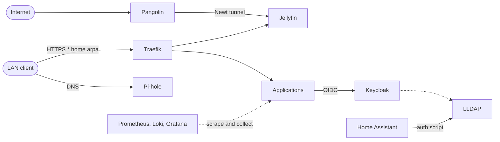

# Swarm Homelab

Docker Swarm stacks and configuration for a small self-hosted homelab. Everything sits behind Traefik on an internal `home.arpa` domain, with single sign-on through Keycloak and LLDAP.

This is a sanitized copy of a working setup. It is meant as a reference, so expect to adapt hostnames, networks and domains to your own environment.

## Architecture



- **DNS:** Pi-hole resolves `*.home.arpa` to the Traefik virtual IP (see `pihole/conf/02-wildcard-homelab.conf`).
- **High availability:** Keepalived moves the virtual IP between the manager nodes when Traefik stops responding on one of them.
- **Ingress:** Traefik discovers services through Swarm labels, using a read-only proxy instead of the raw Docker socket (`traefik/conf/server.js`).
- **TLS:** a private root CA signs the certificate that Traefik serves. Services that call each other over HTTPS trust that CA through a Swarm secret.
- **Secrets:** all credentials are external Swarm secrets and are not stored in this repository.

## Stacks

| Directory | Services | Purpose |
| --- | --- | --- |
| `traefik` | Traefik, socket proxy, oauth2-proxy | Reverse proxy and forward authentication |
| `pihole` | Pi-hole, nginx | DNS and ad blocking |
| `keycloak` | Keycloak, PostgreSQL | OIDC identity provider |
| `lldap` | LLDAP | User directory |
| `metrics` | Prometheus, Grafana, Loki, Alloy, cAdvisor, node-exporter | Metrics, logs and dashboards |
| `homeassistant` | Home Assistant | Home automation, with LLDAP login |
| `jellyfin` | Jellyfin, Newt | Media server, published through Pangolin |
| `gitea` | Gitea, PostgreSQL | Git hosting |
| `actual` | Actual | Budgeting |
| `archivebox` | ArchiveBox, Sonic | Web archiving |
| `llm` | Ollama, Open WebUI | Local LLM inference and chat UI |
| `minecraft` | Fabric server with Geyser and Floodgate | Minecraft server for Java and Bedrock clients |
| `nut-server` | PeaNUT, plus NUT host configuration | UPS monitoring and shutdown |
| `pangolin` | Pangolin, Gerbil, Traefik | Tunnelled public access (Docker Compose, not Swarm) |
| `keepalived` | Keepalived host configuration | Virtual IP for Traefik (runs on the hosts, not in Swarm) |
| `portainer-deploy` | Portainer server and agent | Ansible playbook that deploys Portainer |

## Nodes

The cluster has three managers and one worker. The managers handle infrastructure and light services, while the worker takes the workloads that need more memory.

| Node | Swarm role | Hardware | Pinned workloads |
| --- | --- | --- | --- |
| `manager1` | Manager | Raspberry Pi 5, 8 GB RAM | Pi-hole, Portainer |
| `manager2` | Manager | Raspberry Pi 5, 8 GB RAM | None |
| `manager3` | Manager | Raspberry Pi 5, 8 GB RAM | Home Assistant, Actual, Open WebUI |
| `worker` | Worker | HP ProDesk 600 G2 mini PC, Intel Core i3-6100T, 32 GB RAM | Keycloak, LLDAP, Jellyfin, Ollama, ArchiveBox, Minecraft |

The cluster mixes architectures. Traefik and the core of the `metrics` stack (Prometheus, Grafana, Loki) run only on managers, so any image scheduled on a manager must publish an ARM build.

Stacks in this repository do not set architecture constraints. To pin a service to one architecture, add `node.platform.arch == aarch64` (managers) or `node.platform.arch == x86_64` (worker) to its `placement.constraints`.

Ollama runs on the worker's CPU, which makes local LLMs slow on this hardware. Treat the `llm` stack as an experiment rather than a responsive assistant.

## Prerequisites

### Cluster

Initialize Swarm, join your nodes, then mark the nodes that may run workloads:

```console
docker node update --label-add schedulable=true <node>
```

Many stacks pin services to specific nodes (`manager1`, `manager3`, `worker`). Replace these hostnames in the `placement.constraints` sections, and in `portainer-deploy/inventories/homelab/`.

### Networks

Most stacks attach to a shared overlay network:

```console
docker network create --driver overlay --attachable homelab
```

Home Assistant also needs a macvlan network to reach devices on the LAN. Adjust the subnet, gateway and parent interface in `homeassistant/conf/macvlan.txt`, then run its two commands.

### DNS and certificates

1. Point `*.home.arpa` at your Keepalived virtual IP in `pihole/conf/02-wildcard-homelab.conf`, or at your Traefik node if you skip Keepalived.
2. Create a private root CA and a wildcard certificate for `*.home.arpa`.
3. Load them as secrets:

```console
docker secret create homelab_root_certificate ca.crt
docker secret create homelab_ssl_certificate homelab.crt
docker secret create homelab_ssl_key homelab.key
```

### Secrets

Create these secrets before deploying the matching stack:

```console
printf '%s' 'value' | docker secret create <name> -
```

| Stack | Secrets |
| --- | --- |
| Shared | `homelab_root_certificate`, `homelab_ssl_certificate`, `homelab_ssl_key` |
| `traefik` | `oauth2_proxy_client_proxy`, `oauth2_proxy_cookie_secret` |
| `keycloak` | `keycloak_postgresql_password`, `keycloak_admin_password` |
| `lldap` | `lldap_jwt_token`, `lldap_key`, `lldap_admin_user_password`, `lldap_smtp_password` |
| `metrics` | `grafana_admin_password`, `grafana_keycloak_client_secret` |
| `gitea` | `gitea_database_password`, `homelab_smtp_password` |
| `actual` | `actual_keycloak_client_secret` |
| `archivebox` | `archivebox_admin_password`, `archivebox_search_backend_password` |
| `llm` | `llm_webui_secret_key`, `llm_keycloak_secret` |
| `jellyfin` | `jellyfin_newt_config` (based on `jellyfin/newt_config.json.example`) |

Two helper scripts are available:

- `gitea/generate_secrets.sh` creates `gitea_database_password`.
- `lldap/generate_secrets.sh` prints a JWT secret and a key seed, which you then load as `lldap_jwt_token` and `lldap_key`.

## Deployment

Run each deployment from inside the stack's directory, because configs use relative paths:

```console
cd traefik
docker stack deploy -c docker-compose.yml traefik
```

A sensible order is:

1. `pihole` and `traefik`
2. `lldap` and `keycloak`
3. `metrics`
4. The remaining applications

Deploy `minecraft` after `metrics`, and keep the stack name `metrics`: Minecraft joins the `metrics_private` network so that Prometheus can scrape it.

The `oauth2-proxy` service and the OIDC applications need a client configured in Keycloak. The client IDs are in each stack's `docker-compose.yml`.

### Portainer

```console
cd portainer-deploy
ansible-galaxy collection install -r requirements.yml
ansible-playbook -i inventories/homelab/inventory deploy_portainer_stack.yml
```

### Pangolin

Pangolin uses Docker Compose and publishes ports 80 and 443 itself, so run it on a separate host. It reads its configuration from `/opt/pangolin/config`:

```console
sudo mkdir -p /opt/pangolin
sudo cp -r pangolin/config /opt/pangolin/config
cd pangolin
docker compose up -d
```

Before starting it, edit `config/config.yml` and `config/traefik/`: set your domain, a random `server.secret`, your SMTP settings and an ACME email.

### UPS monitoring

The `nut-server` stack only runs the PeaNUT web UI. NUT itself runs directly on the hosts:

- `nut-server/server/` goes in `/etc/nut` on the host connected to the UPS.
- `nut-server/client/` goes in `/etc/nut` on the other hosts.

Replace the placeholder `monuser` password in `upsd.users` and both `upsmon.conf` files, and update the UPS host in `client/upsmon.conf`.

### Keepalived

Keepalived runs directly on the Traefik nodes, with one configuration file per node in `keepalived/conf/`. On each node:

1. Replace the `192.168.X.X` placeholders with the node's address, its peers' addresses and the virtual IP.
2. Install the node's file as `/etc/keepalived/keepalived.conf`.
3. Install the health check, which must be executable because `enable_script_security` is on:

```console
sudo install -o root -g root -m 755 keepalived/healthcheck.sh /etc/keepalived/healthcheck.sh
```

The health check requests `/ping` on `traefik.home.arpa` through the local Traefik and expects a `404`. Any other response removes the priority bonus from that node.

The failover order is `manager1`, then `manager2`, then `manager3`. A healthy node gets +10 from the check, so the priorities (108, 104, 100) must stay within 10 of each other: a wider spread would let a failed master keep the virtual IP.

### Minecraft

Replace the placeholder players in `minecraft/conf/ops.json` and `minecraft/conf/whitelist.json` with your own. The Floodgate key (`key.pem`) is not in this repository.

## Before you reuse this

Values in this repository are sanitized or are placeholders. In particular, review:

- **`metrics/grafana/ldap.toml`:** the bind password is masked.
- **`traefik/docker-compose.yml`:** the dashboard's basic auth credentials.
- **`pangolin/config/`:** the domain, secret and SMTP settings.
- **`keycloak/docker-compose.yml`:** Keycloak runs with `start-dev`, which is not suited to an exposed deployment.
- **`archivebox/docker-compose.yml`:** the snapshot list and contents are publicly readable.
